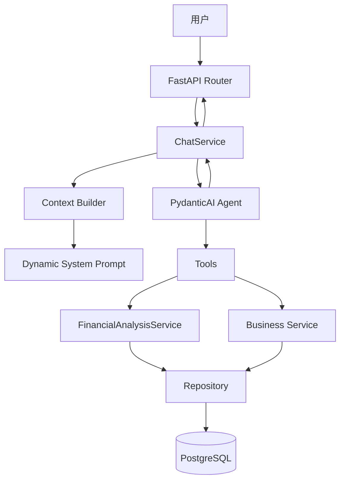
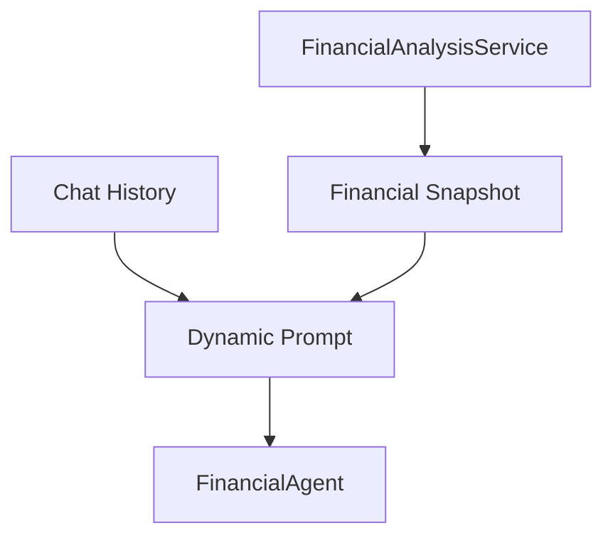
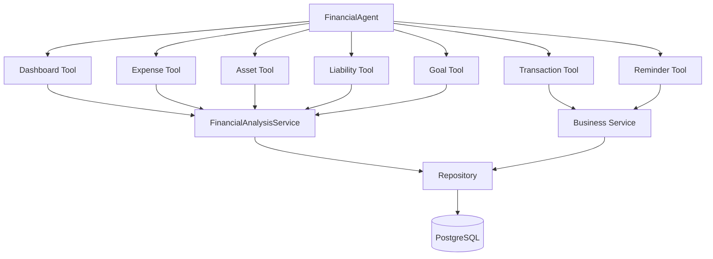

# AI 财务助手（Agent）架构设计

> 版本：V1

技术栈：

- FastAPI
- SQLAlchemy Async
- PostgreSQL
- Pydantic v2
- PydanticAI
- OpenRouter / OpenAI Compatible API

---

# 一、设计目标

Agent 并不是一个聊天机器人，而是个人资产管理平台中的智能财务助手。

定位：

> 一个能够理解用户财务数据、调用业务能力、完成分析与执行动作的 AI 助手。

支持：

- 财务问答
- 资产分析
- 收支分析
- 财务规划
- 自然语言记账
- 创建提醒

不支持：

- 自动投资
- 自动交易
- 投资建议
- 收益承诺

---

# 二、总体架构




---

# 三、项目结构

```text
app
├── agent
│   ├── deps.py
│   ├── prompts.py
│   ├── financial_agent.py
│   ├── context_builder.py
│   └── tools
│       └── fin_analysis.py
│
├── models
│   └── chat.py
│
├── repo
│   ├── financial_analysis.py
│   └── chat.py
|
├── service
│   ├── financial_analysis.py
│   └── agent
│       ├── session.py
│       ├── message.py
│       └── chat.py
│
├── schema
│   └── chat
│
└── view
    └── chat.py
```

---

# 四、职责划分

## Router

负责：

- 参数校验
- Response Schema
- SSE 输出

不负责：

- Agent 调用
- Tool 调度
- SQL

---

## ChatService

负责：

- 创建 Session
- 保存消息
- 加载历史消息
- 调用 Agent
- 保存回答

不负责：

- SQL
- Prompt
- Tool

---

## FinancialAgent

负责：

- 调度 Tool
- 调用模型
- 组织回答

不负责：

- SQL
- CRUD
- ORM

---

## Tool

负责：

调用业务能力。

例如：

```text
expense_analysis()

asset_analysis()

goal_analysis()

create_transaction()

create_reminder()
```

Tool 只调用 Service。

---

## FinancialAnalysisService

负责：

财务分析能力。

例如：

```text
净资产分析

消费分析

资产配置分析

负债分析

目标预测
```

返回：

Business Fact。

不返回：

- ORM
- SQL
- Repository

---

## Repository

负责：

SQL 查询。

例如：

- SUM
- COUNT
- GROUP BY
- JOIN
- Aggregation

---

# 五、数据库

## chat_session

```text
id

user_id

title

status

ctime

utime

deleted_id
```

说明：

- id 使用 ULID
- 当前排序使用 id DESC
- deleted_id 软删除

---

## chat_message

```text
id

session_id

user_id

role

content

tool_name

extra_info(JSON)

ctime

utime

deleted_id
```

说明：

消息排序：

```sql
ORDER BY id ASC
```

---

# 六、聊天流程

```mermaid
sequenceDiagram

    actor User

    participant Router

    participant ChatService

    participant SessionService

    participant MessageService

    participant Agent

    participant Tool

    participant Analysis

    participant Repo

    participant DB

    User->>Router: POST /chat

    Router->>ChatService: chat()

    alt session_id为空

        ChatService->>SessionService: create()

        SessionService->>DB: insert session

        DB-->>SessionService: session

    else 已存在session

        ChatService->>SessionService: detail()

    end

    ChatService->>MessageService: save user message

    MessageService->>DB: insert

    ChatService->>MessageService: load recent history

    MessageService->>DB: query

    ChatService->>Agent: run()

    Agent->>Tool: Tool Calling

    Tool->>Analysis: Analysis Service

    Analysis->>Repo: Query

    Repo->>DB: SQL

    DB-->>Repo

    Repo-->>Analysis

    Analysis-->>Tool

    Tool-->>Agent

    Agent-->>ChatService

    ChatService->>MessageService: save assistant message

    MessageService->>DB

    ChatService-->>Router

    Router-->>User
```


---

# 七、Context Builder

职责：

- 构建历史消息
- 构建动态 Prompt
- 构建财务快照

流程：




Context 不会直接把数据库数据全部发送给模型。

只发送：

- 净资产
- 总资产
- 总负债
- 最近消费
- 资产配置

等摘要信息。

---

# 八、Tool 体系




---

# 九、FinancialAnalysisService

提供统一分析能力。

例如：

```text
net_worth()

expense_analysis()

asset_analysis()

liability_analysis()

goal_analysis()

snapshot()
```

返回：

Business Fact。

例如：

```json
{
    "income":12000,
    "expense":8000,
    "balance":4000
}
```

而不是：

```text
SQLAlchemy ORM
```

---

# 十、聊天接口

## 普通聊天

```
POST /chat
```

Request

```json
{
    "session_id": null,
    "message":"我最近花钱多吗？"
}
```

Response

```json
{
    "session_id":"...",
    "message_id":"...",
    "answer":"最近30天支出..."
}
```

首次聊天：

- session_id 可为空
- 服务自动创建 Session

---

## SSE

```
POST /chat/stream
```

返回：

```mermaid
sequenceDiagram

    actor User

    participant Router

    participant ChatService

    participant Agent

    participant Tool

    User->>Router: POST /chat/stream

    Router->>ChatService

    ChatService-->>User: START

    ChatService-->>User: STATUS

    ChatService->>Agent: run_stream()

    Agent->>Tool: Tool Call

    Tool-->>Agent: Tool Result

    loop stream_text()

        Agent-->>ChatService: token

        ChatService-->>User: CONTENT

    end

    ChatService-->>User: FINISH
```


SSE 事件：

- START
- STATUS
- CONTENT
- FINISH
- ERROR

---

# 十一、设计原则

## Agent 不直接访问数据库

错误：

```text
Agent

↓

SQL
```

正确：

```text
Agent

↓

Tool

↓

Service

↓

Repo
```

---

## Tool 不写 SQL

Tool：

```text
expense_analysis()
```

↓

```text
FinancialAnalysisService
```

↓

```text
Repository
```

---

## Service 不依赖 HTTP

Service 返回：

- DTO
- Business Object

Router：

负责：

- Response Schema
- HTTP Response

---

## Context 尽量短

不要：

- 全部流水
- 全部资产
- 全部负债

只发送：

Business Snapshot。

---

# 十二、后续规划

- Tool 调用日志
- Conversation Summary
- 长上下文压缩
- 流式 Tool Event
- 自然语言预算规划
- 多 Agent
- Langfuse / OpenTelemetry
- MCP 外部工具接入

